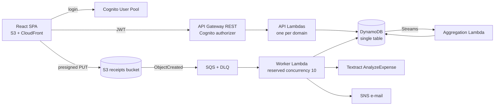

# Architecture

Serverless and event-driven on AWS (Learner Lab, `us-east-1`). The full reasoning is in the [proposal](project/kassenzettel.md), chapter 2. This page is the working summary; keep it in sync with `template.yaml`.

## Components

| Component | Status | Owner |
|---|---|---|
| Cognito, API Gateway, DynamoDB table | scaffolded | @timonrieger, @nosernoel |
| Households API (create, get) | scaffolded (reference pattern) | @nosernoel |
| S3 bucket, presigned upload | planned | @timonrieger, @RR02-rr |
| SQS + DLQ, worker, Textract | planned | @Dam-Mil |
| DynamoDB Streams aggregation | planned | @nosernoel |
| SNS notifications | planned | @Dam-Mil |
| Account deletion queue + worker | planned | @Dam-Mil |
| S3 + CloudFront hosting | planned (prod stack only) | @timonrieger |
| CloudWatch alarms + dashboard | planned | @schmid277 |

Update the status column when something lands.

## Upload flow

1. Frontend asks the API for a presigned URL. The API creates the receipt id and puts it in the S3 key.
2. Frontend uploads directly to S3. The request ends there.
3. S3 event → SQS → worker. The worker switches status `uploaded → processing` with a conditional write, so a duplicate delivery is dropped.
4. Worker calls Textract, categorizes items by keyword rules, writes receipt and items, sets `done`.
5. SNS notifies the user. The frontend polls the status.
6. After 3 failed attempts the message goes to the dead-letter queue.

## Data model

One DynamoDB table, `bonbon-<stage>`, keys `PK` / `SK`. Everything belongs to a household partition, so one query returns all of a household's data and households are isolated.

| Item | PK | SK | Status |
|---|---|---|---|
| Household | `HH#<id>` | `META` | implemented |
| Member | `HH#<id>` | `MEMBER#<userId>` | implemented |
| Receipt | `HH#<id>` | `RECEIPT#<receiptId>` | planned |
| Item | `HH#<id>` | `ITEM#<receiptId>#<n>` | planned |
| Monthly totals | `HH#<id>` | `MONTH#<yyyy-mm>` | planned |
| Invite code | `INVITE#<codeHash>` | `META` (TTL 48 h) | planned |

Still to design (@nosernoel): the index for "receipts by month" and the lookup "which households is user X in" (GSI or `USER#<id>` items). Record the decision as an ADR.

## Security

- API Gateway checks the Cognito JWT on every route except CORS preflight.
- Every Lambda additionally checks household membership in the database (`require_membership`), so leaving a household takes effect immediately.
- Non-members get 404, not 403, so household ids can't be probed.
- Receipts live in a private, encrypted bucket and are reachable only via short-lived presigned URLs.
- Learner Lab limitation: all functions share the `LabRole`, so per-function least-privilege IAM isn't possible. This is documented as a known limitation.

## Environments

| Stack | Account | Deployed by | How |
|---|---|---|---|
| `bonbon-dev` | each person's own Learner Lab | that person | `mise run dev` / `mise run stack:up` |
| `bonbon-prod` | @timonrieger's Learner Lab | @timonrieger | `mise run deploy:prod` from `main` |

See [decisions/0004](decisions/0004-per-person-cloud-dev-stacks.md).
